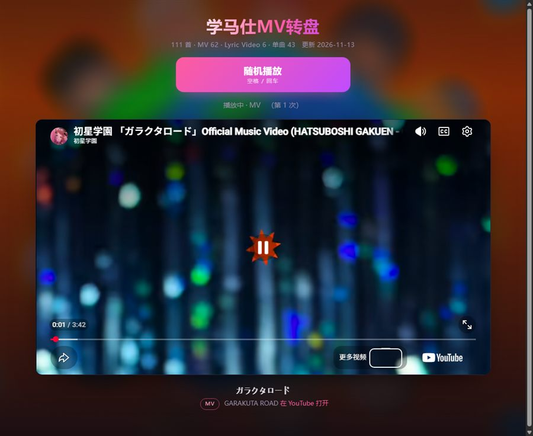

# 学马仕MV转盘

从「初星学園」官方 YouTube 频道随机抽一支视频播放的静态站点。点一下按钮转动盘，出一支 MV、Lyric Video 或单曲，按钮始终留在原地。

**在线：<https://licoriceh.github.io/shuki-roulette/>**



## 玩法

- **随机播放**：按钮常驻，播放中、播完、出错都在。快捷键 `空格` / `回车`
- **不连续重复**：整个曲池洗牌成环，111 支轮完一轮才重洗，同时排除上一支
- **封面即背景**：整页背景用当前曲的 YouTube 缩略图模糊化，播放器内铺同一张原图
- **不剧透**：从点下去到出画的 1～2 秒里，页面只显示「正在打开…」，曲名、模糊背景、新封面统一等 `state=1` 才上
- **自动连播**：播放器下方的开关，开启后一曲自然播完 0.45 秒就自动抽下一支，状态存 `localStorage`，刷新后保持
- **自动兜底**：视频被禁止嵌入或删除时，`onError` 把它标记为 dead 并立即重抽；14 秒连不上 YouTube 就收起播放器，换成「在 YouTube 打开」直链

## 曲池

```
111 首 = MV 62 + Lyric Video 6 + 单曲 43
```

「单曲」指的是官方音乐播放列表里那些只有一张静态封面 + 音频的视频。筛选规则全部写在 `tools/refresh.mjs`：

| 规则 | 说明 |
|---|---|
| Remix Visualiser 整类不收 | 12 首 Remix 的静态可视化视频 |
| 剔除短时长与竖屏 | `< 120s` 或「高 > 宽」的宣传短片、竖屏预览 |
| 短视频不当结果 | 标题带 `#shorts`、`Solo ver.`、`Teaser` 的一律跳过 |
| 同曲留完整版 | 同一首曲多次上传时保留时长最长的（如「空と約束」的 291s 正片压过 59s / 60s 剪辑版） |
| 单曲只留原版 | 按去掉括号内容后的曲名去重：有原版只留原版；整首只有阵容版的则全部保留（当前例外是「修楽旅行」两个阵容版） |
| 只收可嵌入的 | 逐条打 oEmbed，401 / 403 的不进池子 |

## 数据从哪来

- **频道全量上传**：`youtubei/v1/browse` 打 `VL+UU2dXx-3RXeeP8hA5AGt8vuw`，按 `continuation` 翻页，拿到 252 条（含 Shorts）。2025 年后返回的是 `lockupViewModel` 结构，旧的 `playlistVideoRenderer` 已经取不到数据
- **13 个官方播放列表**：Music 全曲目清单 + 12 名角色的 solo 曲列表，用来认出「只有一张图的单曲」
- **元数据**：`youtubei/v1/player` 取 `lengthSeconds` 与 `streamingData` 的视频宽高，判时长与画幅
- **可嵌入性**：`youtube.com/oembed`，200 才算可播

跑在 GitHub Actions 上，`cron: 17 */6 * * *`，一次约 3 分钟。runner 出口在境外，直连 YouTube，不需要任何代理。抓取失败时脚本自动退到 RSS（最近 15 条）并与仓库快照合并；两级都挂了也只会标记失败，部署继续用仓库里的 `data/videos.json`，站点不会空。

## 本地跑

```
serve.cmd     # http://127.0.0.1:8801/
refresh.cmd   # 抓一次数据，约 25 秒
```

`refresh.cmd` 里预设了 `HTTP_PROXY=http://127.0.0.1:7890`，换端口改那三行。`file://` 直接打开不行，`fetch(data/videos.json)` 会被 CORS 拦。

## 结构

| 文件 | 作用 |
|---|---|
| `index.html` / `style.css` / `app.js` | 站点本体。原生 JS，无框架无构建 |
| `data/videos.json` | 曲池（生成物，同时兼作 CI 失败时的兜底快照） |
| `tools/refresh.mjs` | 抓取 + 归类 + 过滤 + 校验，唯一的数据入口 |
| `tools/test-embed.html` | 验证 YouTube 嵌入能不能播的最小页面 |
| `refresh.cmd` / `serve.cmd` | Windows 双击入口 |
| `.github/workflows/deploy.yml` | GitHub Pages 构建与部署 |
| `deploy/cloudflare-pages.yml.sample` | 换 Cloudflare Pages 时用的 workflow |
| `DEPLOY.md` | 上线方案与托管对比 |
| `PLAN.md` | 设计过程与实测数据存档 |

## 首播延迟

点击到出画面：**约 8s → 约 2.5s**。三段改动：

1. 页面空闲时预建 `YT.Player` 并 cue 一支，点击时只走 `loadVideoById` / `playVideo`
2. `iframe_api` 用 `<script async>` 提前到 `<head>` 并行加载，比原来早约 1.8 秒
3. 背景图改用 640×480 的 `sddefault` 并在点击时预取进缓存，出画那一刻零等待

带 `?debug=1` 打开页面，右下角会显示各阶段的时间戳。剩下的耗时全在首个视频分片下载，由网络决定。

## 声明

非官方粉丝作品。所有视频与图像版权归 Bandai Namco Entertainment / 初星学園 所有，本站只做 YouTube 官方播放器的嵌入，不托管任何音视频文件。
